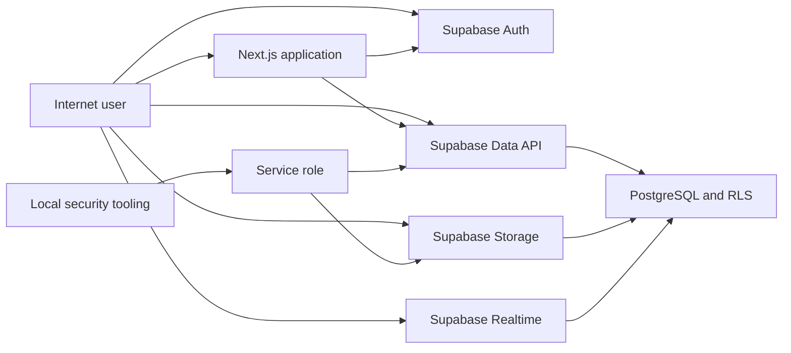

# GGMarket Threat Model

## Executive summary

GGMarket's highest-risk boundary is the internet-reachable Supabase project: browser and server clients use the public Data API, Auth, Realtime, and Storage services, while RLS and function authorization provide the main isolation between marketplace users. The current schema has strong owner and participant policies, constrained Storage paths, private draft images, and narrow moderation functions. The most important remaining risks are configuration drift between migrations and the deployed project, accidental service-role use against the wrong environment, malicious image content, authentication abuse, and future changes that weaken RLS or privileged RPC checks.

## Scope and assumptions

- In scope: `app/`, `components/`, `lib/`, `proxy.ts`, `next.config.ts`, `supabase/migrations/`, `scripts/security-audit.mjs`, `scripts/phase2-security-audit.mjs`, and security-relevant tests.
- Runtime: Next.js 16 App Router, TypeScript/React, Supabase Auth, PostgREST/PostgreSQL, Realtime, and Storage.
- Deployment assumption supplied by the owner: pre-production/local Next.js application; Supabase may be reachable from the internet; no confirmed Vercel production deployment, WAF, CDN policy, or real customer transactions.
- Data assumption: development/test identities and marketplace data may exist and must be treated as private.
- Out of scope: destructive remote testing, production deployment configuration that is not present in the repository, Supabase organization/account controls, and third-party SMTP internals.
- Open questions that change risk: final hosting/proxy behavior, Supabase Auth and bot-protection settings, expected production user scale, and whether public seller aggregates are an intentional product contract.
- Quality check: all discovered request, Data API, Auth, Storage, Realtime, and test-tool boundaries are represented below; runtime and development tooling are separated; owner-provided deployment context is reflected.

## System model

### Primary components

- Browser UI and native forms in `app/` and `components/`.
- Next.js proxy, Route Handlers, Server Components, and authentication helpers.
- Supabase Auth for sessions and identity.
- Supabase Data API over PostgreSQL tables, RLS policies, triggers, and RPC functions.
- Supabase Storage for listing images and Realtime for private conversation events.
- Local E2E/security tooling with service-role access.

### Data flows and trust boundaries

- Internet browser -> Next.js: HTTP requests, cookies, form/JSON input, route parameters, and headers. Supabase SSR validates sessions; Zod validates most bodies; the proxy checks mutation origins; no repository-level rate limiter is present.
- Browser -> Supabase Auth/Data API: credentials, JWT-backed queries, listing images, and marketplace mutations over HTTPS. Public keys identify the project; RLS, grants, and Storage policies authorize operations.
- Next.js -> Supabase: session cookies and public-key API calls over HTTPS. Route Handlers enforce identity and resource filters, while RLS remains authoritative.
- PostgreSQL Data API -> privileged functions: authenticated RPC arguments cross into `SECURITY DEFINER` functions. Functions pin an empty `search_path` and validate caller identity, participant membership, ownership, or admin state.
- Browser -> Realtime: private conversation topics and Postgres changes over WebSocket. Topic policies require conversation membership.
- Local security tooling -> Supabase service role: unrestricted test setup and cleanup over HTTPS. The key bypasses RLS; scripts currently lack a disposable-project guard.
- Storage object -> browser: short-lived signed URLs. Database and Storage policies admit active listing images or the owning seller/admin; content is not decoded or re-encoded by the application.

#### Diagram

## Assets and security objectives

| Asset | Why it matters | Security objective (C/I/A) |
| --- | --- | --- |
| Sessions and password-reset flows | Account takeover or session swapping affects every private feature | C/I |
| Service-role key | Bypasses all RLS and Storage authorization | C/I |
| Profiles and moderation state | Contains identity, suspension, role, and public reputation data | C/I |
| Draft listings and draft images | Seller-private content before publication | C/I |
| Favorites, saved searches, and view history | Private behavioral and preference data | C |
| Conversations, messages, offers, and trades | Private negotiations and marketplace integrity | C/I/A |
| Reports, verification hashes, and audit logs | Sensitive abuse and trust-and-safety state | C/I |
| Listings and catalog | Public marketplace integrity and availability | I/A |
| Migration chain and RLS policies | Defines the authorization boundary for direct API clients | I/A |

## Attacker model

### Capabilities

- Unauthenticated remote caller with the public Supabase project URL/key and knowledge of public UUIDs.
- Ordinary authenticated user who controls their own profile, listings, uploads, HTTP requests, RPC arguments, and Realtime subscriptions.
- Cross-site attacker who can induce browser requests but cannot read same-origin responses or set forbidden browser headers.
- Attacker who submits malformed, oversized, or mislabeled content to public request and upload surfaces.
- Developer/operator who can accidentally point service-role security tooling at the wrong Supabase project.

### Non-capabilities

- No assumed access to the service-role key, deployment secrets, Supabase dashboard, database connection, or another user's session.
- No assumed compromise of Supabase, TLS, the package registry, developer workstation, or final hosting platform.
- No assumed WAF, CDN, trusted forwarding-header sanitizer, or production-only rate limiter.

## Entry points and attack surfaces

| Surface | How reached | Trust boundary | Notes | Evidence (repo path / symbol) |
| --- | --- | --- | --- | --- |
| API Route Handlers | `/api/**` HTTP methods | Browser -> Next.js | Auth, Zod, proxy origin checks, RLS | `app/api/`, `proxy.ts:26` |
| Native auth routes | `/auth/**` forms and callback | Browser -> Next.js/Auth | Mutation origin gate; safe relative redirects | `app/auth/`, `lib/security.ts` |
| Supabase Data API | Public URL and key | Browser -> PostgreSQL | Grants plus RLS per table/operation | `supabase/migrations/` |
| Privileged RPCs | PostgREST `rpc` | Data API -> definer function | Ownership, participant, and admin checks | `202610030001_phase2_marketplace.sql:165-354` |
| Listing images | Direct Storage upload/read/delete | Browser -> Storage | Private bucket, namespace and metadata policies | `components/sell-wizard.tsx`, `202610030005_production_security_hardening.sql:101-115` |
| Realtime conversation channels | Private WebSocket topic | Browser -> Realtime | Conversation membership policy | `202610030001_phase2_marketplace.sql:340-345` |
| Server rendering/data access | Page request | Next.js -> Supabase | Public client for public data; SSR client for private data | `lib/data.ts`, `lib/phase2-data.ts` |
| Security/E2E scripts | Local CLI | Operator -> service role | RLS bypass, state-changing setup/cleanup | `scripts/security-audit.mjs`, `scripts/phase2-security-audit.mjs` |

## Top abuse paths

1. Account-flow origin poisoning: attacker supplies accepted forwarding headers -> application constructs a reset/confirmation URL for the attacker origin -> victim follows a sensitive token to the wrong host. SEC-001 blocks production header-derived origins.
2. Cross-user marketplace access: authenticated attacker guesses a resource UUID -> calls Data API directly -> RLS must suppress rows and writes -> failure would expose messages, favorites, saved searches, or listings.
3. Privileged RPC abuse: attacker invokes a public RPC with another conversation/listing ID -> definer function bypasses RLS -> missing caller checks would modify another user's negotiation or moderation state.
4. Storage namespace attack: attacker uploads, overwrites, moves, or deletes an object under another seller's path -> Storage policy and metadata trigger must reject ownership mismatch.
5. Malicious image content: attacker labels non-image/polyglot bytes as an allowed MIME type -> Storage accepts the object -> signed URL serves it to users or image infrastructure.
6. Test-tool production accident: operator supplies a service-role key for a valuable project -> runs a security script -> script creates/deletes identities and marketplace rows without verifying the target.
7. Auth abuse: remote attacker automates login, signup, or reset calls -> consumes email/auth capacity or attacks credentials -> repository has no visible edge throttle and depends on Supabase settings.
8. Migration drift: local policies show hardened grants and private Storage -> deployed project misses or diverges from a migration -> direct Supabase callers bypass application expectations.

## Threat model table

| Threat ID | Threat source | Prerequisites | Threat action | Impact | Impacted assets | Existing controls (evidence) | Gaps | Recommended mitigations | Detection ideas | Likelihood | Impact severity | Priority |
| --- | --- | --- | --- | --- | --- | --- | --- | --- | --- | --- | --- | --- |
| TM-001 | Remote/cross-site attacker | Public Next.js deployment accepts client forwarding headers | Poison auth callback/redirect origin or bypass origin comparison | Token disclosure, session swap, unwanted auth mutations | Sessions, reset flows | Safe relative paths; fixed canonical production origin and auth mutation gate (`lib/request-security.ts`, `proxy.ts`) | Final proxy behavior unverified | Pin `NEXT_PUBLIC_SITE_URL`; test deployed headers | Alert on callback hosts and rejected origins | Medium | High | high |
| TM-002 | Authenticated user | Valid account and target UUID | Read or mutate another user's private rows via Data API | Cross-user data exposure or integrity loss | Private marketplace data | Owner/participant RLS and column grants (`supabase/migrations/*`) | Full live cross-user suite not run | pgTAP allow/deny matrix plus disposable-project adversarial runs | Audit authorization errors and unusual UUID probing | Medium | High | high |
| TM-003 | Authenticated/anonymous caller | RPC exposed through PostgREST | Exploit missing check in a definer function | RLS bypass and privileged state change | Negotiations, moderation, verification | Empty `search_path`; explicit participant/admin checks; restricted moderation grant | Some helper RPCs remain executable by `anon` | Explicitly revoke `anon`; test every RPC actor/action | Log RPC authorization failures and transitions | Low | High | medium |
| TM-004 | Authenticated seller | Upload permission on own listing | Store malformed or active content under allowed MIME | Client/image-service exploitation or abusive content distribution | User devices, Storage, trust | Size/MIME allowlists, private bucket, signed URLs | No byte validation, re-encoding, scanning, or moderation | Decode/re-encode images; quarantine until validated | Log decoder failures and abuse reports | Medium | Medium | medium |
| TM-005 | Remote bot | Public Auth endpoints | Automate credential attempts, signup, and email reset | Account attacks, spam, availability/cost impact | Auth, SMTP, availability | Supabase Auth; generic login errors | Rate-limit/bot settings not verified; no visible edge control | Configure Auth/edge throttles and bot protection | Alert on per-IP/account failure spikes | Medium | Medium | medium |
| TM-006 | Developer/operator error | Service-role key and wrong project configuration | Run destructive audit scripts against valuable data | Data deletion, test-account pollution | Database, Auth, Storage | Unique test data and cleanup; documentation warning | No explicit mutation flag/project-ref guard in scripts | Reuse mutation guard and require exact project ref | Log service-role admin operations; separate test project | Medium | High | high |
| TM-007 | Anonymous caller | Knows target UUID | Query public aggregate definer RPCs across private states | Limited metadata/privacy leakage | Seller/listing metadata | Aggregate-only responses; UUID identifiers | Functions bypass row visibility | Restrict inputs to active/public records | Monitor enumeration rate | Low | Low | low |
| TM-008 | Supply-chain attacker/advisory | Vulnerable dependency is reachable | Exploit package vulnerability during runtime or tooling | Code execution or denial of service depending package | Build/runtime integrity | Production `npm audit` clean; lockfile present | Development lint chain has `braces` advisory | Upgrade when compatible; add CI audit gates | Dependency alerts and lockfile review | Low | Medium | low |

## Criticality calibration

- **Critical:** unauthenticated service-role exposure, pre-auth code execution, or broad RLS bypass exposing all private marketplace data. Examples: committed service key; public definer RPC returning all messages; arbitrary SQL/command execution.
- **High:** practical account-flow compromise, cross-user access to private rows, or unauthorized moderation/ownership changes. Examples: reset-token origin poisoning; editing another seller's listing; outsider access to conversations.
- **Medium:** exploitable abuse or partial exposure with meaningful constraints. Examples: malicious image acceptance; auth endpoint automation; anonymous reachability of privileged RPCs that still reject internally.
- **Low:** limited metadata leakage, development-only dependency exposure, or defense-in-depth gaps without a present exploit path. Examples: public aggregate counts; incomplete CSP with no raw-HTML sink; anonymous `is_admin()` returning `false`.

## Focus paths for security review

| Path | Why it matters | Related Threat IDs |
| --- | --- | --- |
| `proxy.ts` | Global session refresh, CSRF boundary, and security headers | TM-001, TM-005 |
| `lib/request-security.ts` | Canonical-origin and mutation trust decisions | TM-001 |
| `app/auth/` | Login, signup, logout, callbacks, and reset links | TM-001, TM-005 |
| `app/api/` | All application mutation endpoints | TM-002, TM-003 |
| `lib/auth.ts` | User/admin identity checks | TM-002, TM-003 |
| `lib/data.ts` | Public/private query separation and output minimization | TM-002, TM-007 |
| `lib/phase2-data.ts` | Private messaging and negotiation reads | TM-002 |
| `supabase/migrations/202610010001_core_schema.sql` | Base tables, grants, RLS, and Storage bucket | TM-002, TM-004 |
| `supabase/migrations/202610020001_phase1_stabilization.sql` | Privilege triggers and Storage path ownership | TM-002, TM-004 |
| `supabase/migrations/202610030001_phase2_marketplace.sql` | Messaging RLS, Realtime, and definer RPCs | TM-002, TM-003, TM-007 |
| `supabase/migrations/202610030005_production_security_hardening.sql` | Private bucket, column grants, suspension, moderation audit | TM-002, TM-003, TM-004 |
| `components/sell-wizard.tsx` | Direct browser upload and metadata creation | TM-004 |
| `scripts/security-audit.mjs` | Service-role cross-user test lifecycle | TM-006 |
| `scripts/phase2-security-audit.mjs` | Service-role messaging/realtime test lifecycle | TM-006 |
